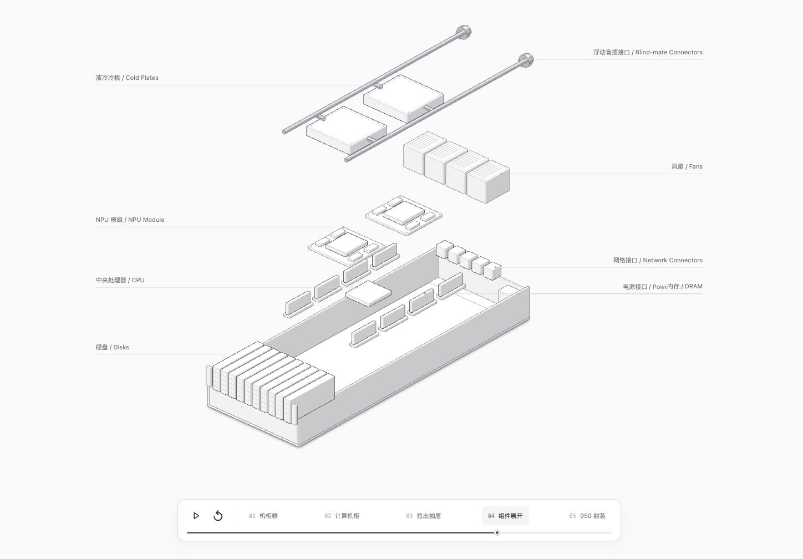

<!-- AI Infra: AI infrastructure visualization, LLM inference diagrams, compiler passes, memory analysis, Ascend hardware architecture. -->

<div align="center">

# AI Infra

**Explore AI infrastructure through interactive diagrams: LLM computation and inference, compiler passes, memory, communication, and Ascend hardware architecture.**

[简体中文](README.md) · **English**

[](COPYRIGHT.md)


[Explore the Library](https://yinyucheng0601.github.io/AI_Infra/ai-infra-research/index.html) · [Interactive Patterns](https://yinyucheng0601.github.io/AI_Infra/ai-infra-research/patterns.html) · [Design Skills](https://yinyucheng0601.github.io/AI_Infra/ai-infra-research/skills.html)

</div>

[](https://yinyucheng0601.github.io/AI_Infra/atlas-950-anatomy/index.html)

## Why AI Infra?

Connect concepts across models, compilers, and hardware through explorable views for technical understanding, design reviews, and shared research.

| Question | What to explore |
| --- | --- |
| How do models and operators organize computation? | Model architectures, Attention computation chains, and tensor relationships |
| How does compilation transform a program? | Compiler passes, dataflow, control scopes, and memory bindings |
| How does an inference request execute? | Prefill / Decode timelines and Host / Device relationships |
| How are memory objects and hardware organized? | Address and lifetime views, plus cabinet-to-NPU exploration |
| How can complex systems be represented in an interface? | Visual primitives, interaction patterns, and design skills |

## Start with These Works

| Work | What you can inspect |
| --- | --- |
| [Atlas 950 Anatomy](https://yinyucheng0601.github.io/AI_Infra/atlas-950-anatomy/index.html) | Continuous isometric exploration from cabinets to compute drawers, components, and the 950DT package |
| [Paged Attention Graph](https://yinyucheng0601.github.io/AI_Infra/ai-infra-research/patterns/paged-attention-graph/Design/Toolkit%20Studio/graph-style-preview.html) | The computation chain through QK Matmul, Softmax, PV Matmul, and Online Update |
| [Compiler Pass Observability](https://yinyucheng0601.github.io/AI_Infra/ai-infra-research/reports/llm-compute/pass-observability-guide/index.html) | Compilation stages, observable objects, and views connected through one MatMul example |
| [Memory Inspector](https://yinyucheng0601.github.io/AI_Infra/ai-infra-research/patterns/memory-inspector/index.html) | Function memory allocations by address and static lifetime, linked to objects and source code |
| [Inference Request](https://yinyucheng0601.github.io/AI_Infra/ai-infra-research/patterns/critical-path-swimlane/index.html) | A shared, zoomable request timeline connecting Host and Device execution |

## Quick Start

**Browse online:** Open the [Library](https://yinyucheng0601.github.io/AI_Infra/ai-infra-research/index.html) and select a card. Online viewing requires no Python, Node, or local dependencies. Click the cover above to open Atlas 950 Anatomy directly.

**Maintain locally:** With an existing checkout, run this command from the repository root to start the preview server (Python 3.10+, standard library only):

```sh
python3 ai-infra-research/scripts/serve.py
```

Open <http://127.0.0.1:8766/>. For full cross-repository source access, configure `ai-infra-research/.local/sources.json` using the [running guide](ai-infra-research/docs/running.md) (Chinese). Some pages have external resource dependencies. The preview server serves only allowlisted resources.

## Repository Structure

```text
AI_Infra/
├── ai-infra-research/
│   ├── catalog/assets.json   # Canonical asset catalog
│   ├── reports/             # Research reports and interactive diagrams
│   ├── patterns/            # Visual and interactive works
│   ├── methods/             # Design methods and skills
│   ├── web/                 # Library page sources
│   └── scripts/             # Build, validation, and local preview
├── atlas-950-anatomy/       # Atlas 950 isometric diagrams
└── atlas-950-explorer/      # Atlas 950 hardware exploration
```

Assets are curated for their design value. `catalog/assets.json` is the single source for the catalog; Library pages are generated from it and `web/`. Edit sources and rebuild when maintaining the site. Asset records retain source references and validation evidence.

## Who It Is For

- **AI infrastructure and developer-tool designers:** Explore computation graphs, timelines, memory views, and multilevel system interactions.
- **Model, compiler, and performance engineers:** Use diagrams to discuss relationships between computation, execution, and storage.
- **Technical leads and research teams:** Find representative work, design reasoning, and source evidence for reviews and discussions.

## FAQ

<details>
<summary>What kind of repository is AI Infra?</summary>

An AI infrastructure design research and interactive visualization collection, with diagrams, reports, patterns, and design methods. Individual design assets are the unit of curation.

</details>

<details>
<summary>Should I start with Library, Patterns, or Skills?</summary>

Use Library to explore content by topic, Patterns to browse interactive works, and Skills to find design methods, examples, and their workflows.

</details>

<details>
<summary>Do I need dependencies or an NPU to browse online?</summary>

No NPU or local development dependencies are required. Open the published pages in a browser. Some pages need network access for external fonts or other resources.

</details>

<details>
<summary>How do I preview locally, and why are some sources unavailable?</summary>

Start the preview server above with Python 3.10+. Cross-repository originals require source mappings; cloning this repository does not automatically provide those sources. See the running guide for configuration.

</details>

<details>
<summary>Can I copy diagrams, reuse code, or use this in commercial work?</summary>

Original content is all rights reserved; public access does not grant reuse permission. See the complete terms below and [COPYRIGHT.md](COPYRIGHT.md). Separately licensed third-party materials retain their own licenses.

</details>

## Feedback and Maintenance

Report broken links, content issues, or interaction bugs through [GitHub Issues](https://github.com/yinyucheng0601/AI_Infra/issues), including the page URL, reproduction steps, and expected behavior. Maintainers should read the [scope rules](ai-infra-research/docs/scope.md) and [contribution workflow](ai-infra-research/docs/contributing.md) before adding assets (Chinese).

Validate the catalog from the repository root:

```sh
python3 ai-infra-research/scripts/validate_catalog.py
```

**Make the connections between models, compilers, and hardware visible.**

## Credits

Atlas 950 Anatomy was built with Ryan’s [Anatomy Skill](https://github.com/wheresryan22/anatomy), including its isometric illustration approach and geometry toolkit. [Website](https://skills.wheresryan.sh/anatomy) · [Original MIT license](atlas-950-anatomy/ANATOMY-LICENSE.txt)

[Maintenance guide](ai-infra-research/README.md) · [Contact](https://github.com/yinyucheng0601)

---

## Copyright

All rights reserved. Public access does not grant an open-source license or permission to reuse this work. Third-party materials retain their respective licenses. The complete original terms are preserved below and in [COPYRIGHT.md](COPYRIGHT.md).

<details>
<summary>Full original copyright and usage terms (Chinese)</summary>

## 版权与使用限制

Copyright © 2026 yinyucheng0601 及相关权利人。**保留全部权利（All Rights Reserved）。**

本声明适用于本仓库及其 GitHub Pages 网站中由仓库作者享有权利的原创内容，包括代码、文档、研究报告、文字、图表、插图、界面与交互设计、动画、演示、模板和其他原创资产。本声明不授予开源许可或一般性非商业使用许可。

除适用法律允许、适用平台条款要求或相关权利人另行明确授权的范围外，未经相关权利人事先书面许可，禁止以下行为：

1. **任何商业使用**：包括销售、付费分发、商业产品或服务集成、企业内部业务使用、客户项目交付、咨询、付费培训、广告、营销、引流，以及其他直接或间接获取商业利益的使用。
2. **复制与传播**：复制、转载、摘编、翻译、出版、上传、镜像、再分发或在其他网站、平台及资料库中展示全部或部分受保护内容；免费分享或注明出处不构成授权。
3. **修改与衍生使用**：改编、修改、移植、二次开发、提取或复用受保护的代码、图表、设计及其他资产，或据此制作、发布衍生作品。
4. **批量采集与模型使用**：抓取、批量下载或整理受保护内容用于数据集、模型训练、微调、蒸馏、评测或其他人工智能产品与服务。
5. **权利标识与转授权**：删除、遮盖或篡改版权声明、署名、水印和来源信息；冒充原创作者；擅自转授权或声称对本仓库内容享有所有权。

### 授权、例外与第三方内容

- **授权须明确取得**：任何超出法律及平台允许范围的使用，包括非商业使用，均须事先获得相关权利人的书面许可。可通过 [仓库所有者 GitHub 主页](https://github.com/yinyucheng0601) 联系。未回复不构成同意；授权仅在书面约定的用途、范围及期限内有效。
- **公开不等于授权**：仓库或网站可访问、可下载、可查看源码，不代表获得商用、转载、修改或再分发许可。GitHub 服务条款允许的平台内查看及 Fork 等行为，以该条款为限，不额外授予平台外使用权。
- **保留法定例外**：本声明不限制适用法律规定的合理使用、合理引用及其他不可排除的权利，也不主张对不受著作权保护的事实、思想或方法享有排他权。
- **尊重第三方权利**：第三方代码、依赖、字体、图片、引用材料及其他明确标注独立许可的内容，仍按各自原有许可及权利声明处理，本声明不改变或收回其授权。例如，仓库中的 `liquid-glass-controls` 第三方内容适用其随附的 MIT License。第三方许可不自动延伸至本仓库其他原创内容。
- **既有授权**：本声明不追溯撤销已合法授予且仍有效的许可；相关内容应按其适用版本的授权条款处理。

对于未经授权的使用，相关权利人保留依法要求停止侵权、删除侵权内容、赔偿损失及采取其他法律救济措施的权利。

</details>
