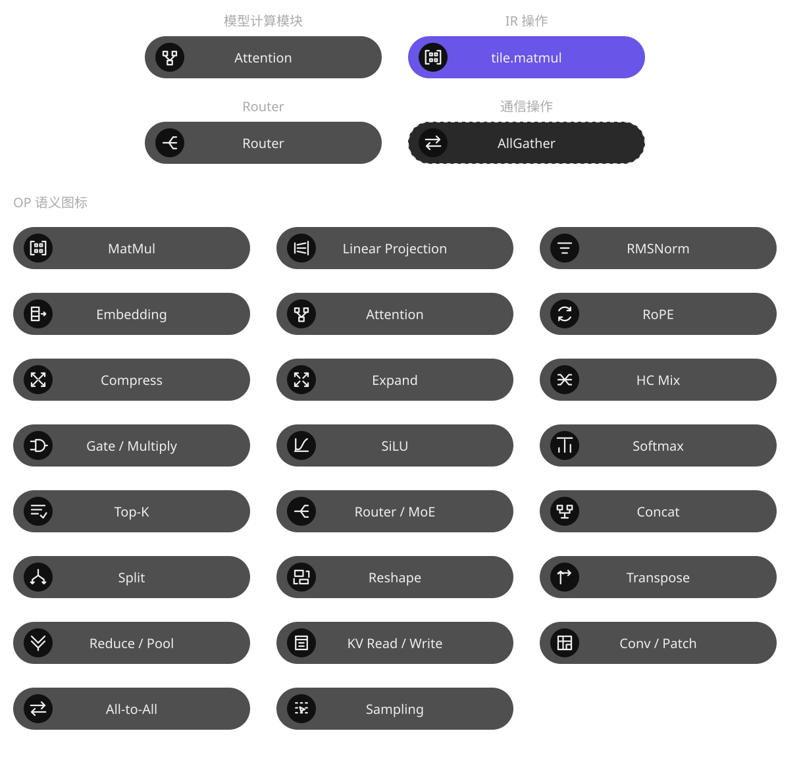

# 计算可视化图元体系

为计算、编译、存储、部署和运行关系提供一致的视觉对象。它负责选对并复用图元，不负责猜测关系，也不决定整页怎么排。

## 图元样例

以下 SVG 直接提取自正式图例库，保留其标签、形状与数据角色。点击后文的图例库入口可查看变体、来源与完整说明。






## 适合用来做什么

- 需要使用 Tensor、OP、存储或任务图元
- 修复标签位置、类别图标等样式漂移
- 检查旧图元与正式库版本是否一致

## 快速开始

[下载 Skill ZIP](../ai-infra-glyphs.zip)

将完整目录按所用 coding agent 的 Skill 机制配置；也可以直接让 agent 读取 checkout 内的 `SKILL.md`。保留 references、assets 和 scripts 等资源，不要只复制入口文件。

在已有任务会话中提供资料位置与具体问题，然后使用下面的 prompt。将方括号替换成你的任务。

```text
使用 ai-infra-glyphs，为 [对象与关系列表] 选择计算图元。
先核对正式图例库的 item、variant 和 renderer，复用实际实现。
保留 Tensor 标签结构、OP 类别图标和数据角色。
缺少表达时列出候选，不自动新增正式图元。
```

## 输入与交付

| 项目 | 内容 |
| --- | --- |
| 输入 | 已确认的对象类型、关系和需要表达的状态。 |
| 交付 | 图元 item / variant 对应表、实际 SVG 或 renderer 接入，以及来源指纹。 |

## 如何复用

先从领域模型确认“这是什么对象、关系表示什么”，再选正式 item 与 variant。复用实际 SVG 或 renderer；Tensor 标签、OP 类别图标和数据角色不由宿主 CSS 重写。逐元素检查矩阵与抽象 Tensor 分开处理。

[浏览正式图例与 Pattern 库](../../reports/llm-compute/diagram-legend-library/index.html)

正式库是维护源，包内 assets 是附来源指纹的分发快照。来源不可用时可使用快照已有表示；缺少参数化 renderer 就报告限制，不把静态 SVG 宣称为任意布局生成器。

## 能力边界

正式图例库是维护源；Skill 包内是带来源指纹的分发快照。静态图元不等于任意参数化布局能力。

## 验证与反馈

目前的格式、引用、包完整性与页面脚本检查，不等于真实任务下的收益验证。反馈时请附任务、使用版本、输入类型、卡住的步骤和期望结果；公开反馈前去除私有代码、路径与数据。

## 相关入口

- [总 workflow](../ai-infra-investigation/README.md)
- [完整执行指令](SKILL.md)
- [仓库与维护关系](../README.md)

README 面向使用者，SKILL.md 面向执行任务的 agent。下载包是当前构建快照，不会自动更新。
