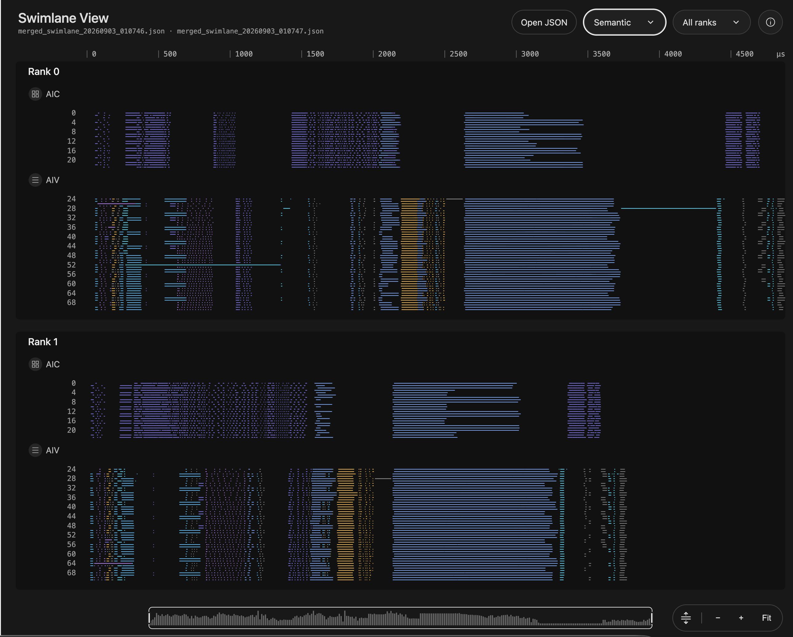

# AI Infra 计算可视化 · 总 workflow

让 coding agent 在训练与推理开发中，按任务生成可操作、可追溯的计算视图。你提出问题，它组织领域分析、图元和界面；你选中对象，再带着证据继续核查。

## 效果示例




## 适合用来做什么

- 模型或计算关系难以用文字讲清
- 需要核对索引、布局、编译或部署关系
- 已有运行数据，需要联动查看事件与来源

## 快速开始

首次使用建议获取完整 workflow，而不是只下载调度 Skill。组合包包含六个同级 Skill 目录：总入口、两个领域能力、计算图元、证据工作台和 Systems UI。

[下载完整 workflow](../ai-infra-investigation-workflow.zip) · [仅下载调度 Skill](../ai-infra-investigation.zip)

将完整目录按所用 coding agent 的 Skill 机制配置；也可以直接让 agent 读取 checkout 内的 `SKILL.md`。保留 references、assets 和 scripts 等资源，不要只复制入口文件。

在已有任务会话中提供资料位置与具体问题，然后使用下面的 prompt。将方括号替换成你的任务。

```text
使用 ai-infra-investigation workflow 分析 [仓库 / 配置 / trace]。
我想核对：[具体问题]。
先读取项目约束与已有证据，判断适合的视图与领域路径。
复用计算图元、证据工作台和 Systems UI，生成可交互视图。
关联来源与分析前提；没有运行数据不推断实测时间。
不修改被分析代码，分别说明已验证和待确认项。
```

## 输入与交付

| 项目 | 内容 |
| --- | --- |
| 输入 | 代码仓库、配置或 trace，以及你想理解或核对的问题。 |
| 交付 | 可交互页面、对象与源码/数据的关联、验证记录和可复制的调查上下文。 |

## 工作方式

你描述任务，不必先指定 Pattern。agent 先判断文字是否足够，再选择领域路径；需要视图时，复用已有模型、图元和交互，不从零重画整页。

| 阶段 | 负责内容 | Skill |
| --- | --- | --- |
| 领域：计算与系统 | 模型、编译、并行部署、运行证据的关系组织 | [大模型计算图解](../llm-compute-diagrams/README.md) |
| 领域：索引与布局 | 生效分支、数学集合、请求和计算范围 | [算子映射调查](../operator-mapping-investigation/README.md) |
| 图元 | 从正式库选择 Tensor、OP、存储和关系表示 | [计算可视化图元体系](../ai-infra-glyphs/README.md) |
| 证据 | 对象身份、检查器、前提与问题交接 | [证据工作台](../observability-design-style/README.md) |
| 界面 | 布局、尺度、选择、缩放和面板 | [Systems UI](../design-spatial-systems-ui/README.md) |

这是按需调度，不要求每个任务走完全部阶段。已有数据模型可直接进入呈现；只核对公式时也可以停在分析，不生成页面。

## 一个实际例子：LogSumExp Case05

开发者要核查非末轴归约的输入与搬运关系。agent 先固定源码版本，再区分数学归约集合、源码请求槽和参与计算范围，生成可选择的矩阵与布局视图。用户选择一个输出或搬运组，打开对应源码，填写问题并复制证据，回到原会话继续核查 API。

[打开归约访存检查样例](../../patterns/reduction-memory-inspector/index.html)

这个样例固定于 Case05，没有运行 NPU。它证明了一条可操作的调查链，不证明所有算子都已有适配，也不把额外请求直接判定为错误。

## 能力边界

这是 workflow 调度入口，不是自动诊断引擎。不同框架与 API 仍需要领域适配。完整包包含六个 Skill；只下载调度 Skill 不包含其余能力。

没有 trace 时不画实测时长，没有 API 依据时保留未知；源码模型、CPU 数值检查、真实渲染与设备运行分别报告。全流程是任务路由范围，不表示已具备所有框架的自动解析器。

## 验证与反馈

目前的格式、引用、包完整性与页面脚本检查，不等于真实任务下的收益验证。反馈时请附任务、使用版本、输入类型、卡住的步骤和期望结果；公开反馈前去除私有代码、路径与数据。

## 相关入口

- [完整执行指令](SKILL.md)
- [仓库与维护关系](../README.md)

README 面向使用者，SKILL.md 面向执行任务的 agent。下载包是当前构建快照，不会自动更新。
