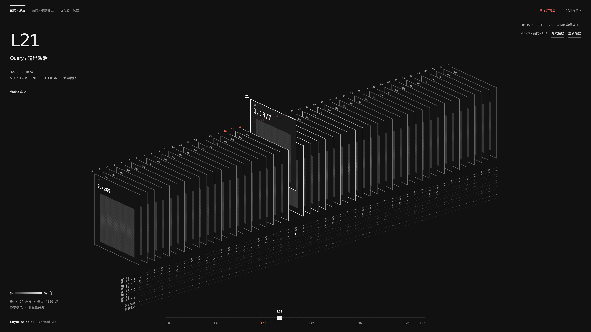

# Spatial Systems UI

为复杂系统视图安排清楚的空间秩序。让数据主体、选择和检查器各有位置，用布局与交互减少解释负担。

## 效果示例




## 适合用来做什么

- 矩阵、拓扑、时间线或画布层次混乱
- 主体拥挤、字号失衡或面板遮挡
- 需要统一选择、缩放、聚焦和面板交互

## 快速开始

[下载 Skill ZIP](../design-spatial-systems-ui.zip)

将完整目录按所用 coding agent 的 Skill 机制配置；也可以直接让 agent 读取 checkout 内的 `SKILL.md`。保留 references、assets 和 scripts 等资源，不要只复制入口文件。

在已有任务会话中提供资料位置与具体问题，然后使用下面的 prompt。将方括号替换成你的任务。

```text
使用 design-spatial-systems-ui 优化 [页面 / 视图]。
当前任务是 [用户需要完成的操作]。
保留领域模型和正式图元语义，优先调整布局、尺度与交互。
主体优先，解释按需展开，选择不要重置视角。
```

## 输入与交付

| 项目 | 内容 |
| --- | --- |
| 输入 | 已有数据与关系、用户任务、目标环境和已确认设计资产。 |
| 交付 | 符合项目约束的界面布局、尺度与交互实现，以及呈现检查记录。 |

## 如何使用

先确认用户要看什么、选什么、下一步做什么，再安排主体、检查器与外围控制。布局不清楚时先调整位置、分组和尺度，而不是增加解释文字。保持已有图元语义，并遵守项目已确认的材质和交互。

它适合矩阵、拓扑、时间线和空间画布；不要求所有页面采用 3D，也不为普通表格后台强制增加空间效果。领域数据不完整时只呈现已确认关系。

## 能力边界

负责如何呈现，不替代领域分析；已有确认样式与项目规则优先。

## 验证与反馈

目前的格式、引用、包完整性与页面脚本检查，不等于真实任务下的收益验证。反馈时请附任务、使用版本、输入类型、卡住的步骤和期望结果；公开反馈前去除私有代码、路径与数据。

## 相关入口

- [总 workflow](../ai-infra-investigation/README.md)
- [完整执行指令](SKILL.md)
- [仓库与维护关系](../README.md)

README 面向使用者，SKILL.md 面向执行任务的 agent。下载包是当前构建快照，不会自动更新。
