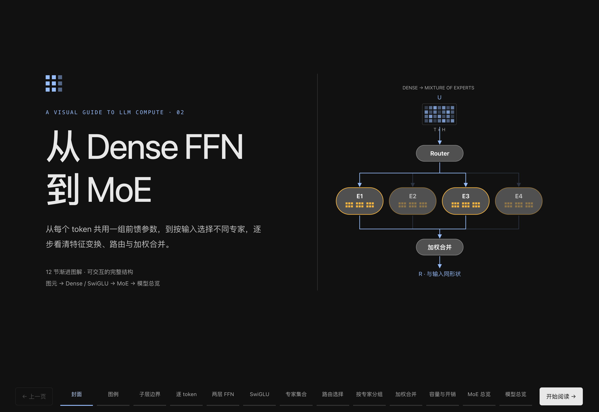

# 大模型计算图解

把模型与计算机制组织成逐步可理解的交互图解。适合解释训练、推理、并行通信和编译关系，让读者操作并理解结构。

## 效果示例




## 适合用来做什么

- 解释 Transformer、Dense / MoE 或推理机制
- 梳理并行通信与编译流程
- 制作可离线阅读的渐进交互图解

## 快速开始

[下载 Skill ZIP](../llm-compute-diagrams.zip)

将完整目录按所用 coding agent 的 Skill 机制配置；也可以直接让 agent 读取 checkout 内的 `SKILL.md`。保留 references、assets 和 scripts 等资源，不要只复制入口文件。

在已有任务会话中提供资料位置与具体问题，然后使用下面的 prompt。将方括号替换成你的任务。

```text
使用 llm-compute-diagrams 解释 [计算机制]。
依据 [源码 / 配置 / 资料]，组织从整体到局部的交互图解。
复用正式图元，关联来源，保留关键 shape 与关系。
输出可离线打开的 HTML。
```

## 输入与交付

| 项目 | 内容 |
| --- | --- |
| 输入 | 具体认知问题、可核查的模型源码/配置/论文或数据。 |
| 交付 | 带来源、统一图元和渐进交互的独立 HTML。 |

## 使用示例

解释 Dense FFN 与 MoE 时，用连续案例展示输入、路由、专家与合并关系，最后汇合完整图。讲解页可以逐步展开；若目标是定位某段源码的映射差异，应转入调查 workflow，而不是默认生成课程。

[查看渐进图解示例](assets/reference-guide.html)

## 能力边界

具体源码的索引与布局核查使用算子映射调查；需要完整证据工作台时使用总 workflow。

## 验证与反馈

目前的格式、引用、包完整性与页面脚本检查，不等于真实任务下的收益验证。反馈时请附任务、使用版本、输入类型、卡住的步骤和期望结果；公开反馈前去除私有代码、路径与数据。

## 相关入口

- [总 workflow](../ai-infra-investigation/README.md)
- [完整执行指令](SKILL.md)
- [仓库与维护关系](../README.md)

README 面向使用者，SKILL.md 面向执行任务的 agent。下载包是当前构建快照，不会自动更新。
