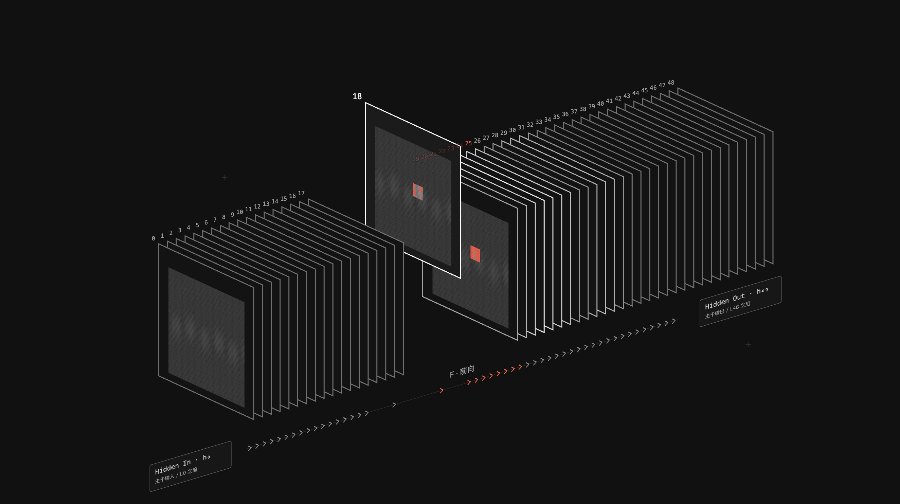

# 证据工作台 · 信息组织

把已有分析结果组织成开发者能继续工作的证据工作台：先定位对象，再看差异、核查来源，最后带着问题继续调查。

## 效果示例




## 适合用来做什么

- 检查器里属性很多，但重点不清楚
- 图中有调查候选，需要说明依据和前提
- 需要人与 agent 共享精确选择与证据

## 快速开始

[下载 Skill ZIP](../observability-design-style.zip)

将完整目录按所用 coding agent 的 Skill 机制配置；也可以直接让 agent 读取 checkout 内的 `SKILL.md`。保留 references、assets 和 scripts 等资源，不要只复制入口文件。

在已有任务会话中提供资料位置与具体问题，然后使用下面的 prompt。将方括号替换成你的任务。

```text
使用 observability-design-style 整理 [现有分析界面]。
让用户清楚当前对象、值得核查的关系、依据和下一步操作。
压缩普通属性，必要前提就近可见，长证据按需展开。
复制内容包含选择、问题、参数与来源，不改变领域结论。
```

## 输入与交付

| 项目 | 内容 |
| --- | --- |
| 输入 | 对象模型、稳定 ID、证据、分析条件与未确认项。 |
| 交付 | 总览到检查器的操作路径、详情层级、选择状态和问题与证据的交接结构。 |

## 如何组织证据

以一个输出或事件为例：先给对象身份，再显示值得核查的差异，普通属性压成短行；源码依据、分析前提和长记录按需展开。调查候选与确认失败分开表达，必要前提在关系附近能找到。

交接预览和复制来自同一数据源，包含当前对象、参数、问题与来源。选中不改变数据角色，打开检查器不应丢失对象上下文。

原工作台设计系统保留为来源，历史圆角、材质或 2.5D 布局不是每个页面的固定要求。

## 能力边界

原数据观测工作台规范保留为来源。此 Skill 负责证据组织；当前界面材质与布局由项目设计系统或 Systems UI 决定。

## 验证与反馈

目前的格式、引用、包完整性与页面脚本检查，不等于真实任务下的收益验证。反馈时请附任务、使用版本、输入类型、卡住的步骤和期望结果；公开反馈前去除私有代码、路径与数据。

## 相关入口

- [总 workflow](../ai-infra-investigation/README.md)
- [完整执行指令](SKILL.md)
- [仓库与维护关系](../README.md)

README 面向使用者，SKILL.md 面向执行任务的 agent。下载包是当前构建快照，不会自动更新。
