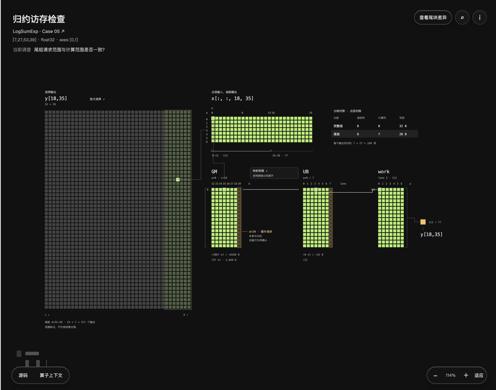

# 算子映射调查

把算子里的多维索引、线性地址和局部缓冲位置整理成可检查的映射模型。先核对元素与访问集合，再交给视图呈现。

## 效果示例




## 适合用来做什么

- 核对非末轴归约、转置或切片的索引
- 区分有效元素、请求槽、padding 与消费范围
- 调查 Host 参数与 Kernel 访问是否对应

## 快速开始

[下载 Skill ZIP](../operator-mapping-investigation.zip)

将完整目录按所用 coding agent 的 Skill 机制配置；也可以直接让 agent 读取 checkout 内的 `SKILL.md`。保留 references、assets 和 scripts 等资源，不要只复制入口文件。

在已有任务会话中提供资料位置与具体问题，然后使用下面的 prompt。将方括号替换成你的任务。

```text
使用 operator-mapping-investigation 分析 [算子 / 用例]。
我怀疑 [索引或布局问题]。固定源码版本，确认生效分支，
分别建立数学集合、源码请求、目标布局与计算集合。
用独立参考核查覆盖、遗漏与重复，不修改算子。
未知 API 行为列为待确认，不为了完成图面猜测。
```

## 输入与交付

| 项目 | 内容 |
| --- | --- |
| 输入 | 固定版本源码、生效分支、输入配置，以及一个映射假设。 |
| 交付 | 独立于渲染的映射模型、精确源码依据、覆盖/遗漏/重复检查与未确认项。 |

## 使用示例

对于归约，先列出某个输出数学上对应的输入，再从源码推导实际请求、目标槽和消费范围。对于转置，核心变为索引置换；对于 Gather / Scatter，先确认间接索引及重复或冲突语义。不能把前一个实现的公式直接套到后一个实现。

模型可独立于页面运行。若只需要核查索引，交付模型、来源与检查结果即可；要加入画布与源码窗口，再调用总 workflow。

## 能力边界

单独使用可只交付分析和模型；需要完整调查界面时，从总 workflow 开始。

## 验证与反馈

目前的格式、引用、包完整性与页面脚本检查，不等于真实任务下的收益验证。反馈时请附任务、使用版本、输入类型、卡住的步骤和期望结果；公开反馈前去除私有代码、路径与数据。

## 相关入口

- [总 workflow](../ai-infra-investigation/README.md)
- [完整执行指令](SKILL.md)
- [仓库与维护关系](../README.md)

README 面向使用者，SKILL.md 面向执行任务的 agent。下载包是当前构建快照，不会自动更新。
